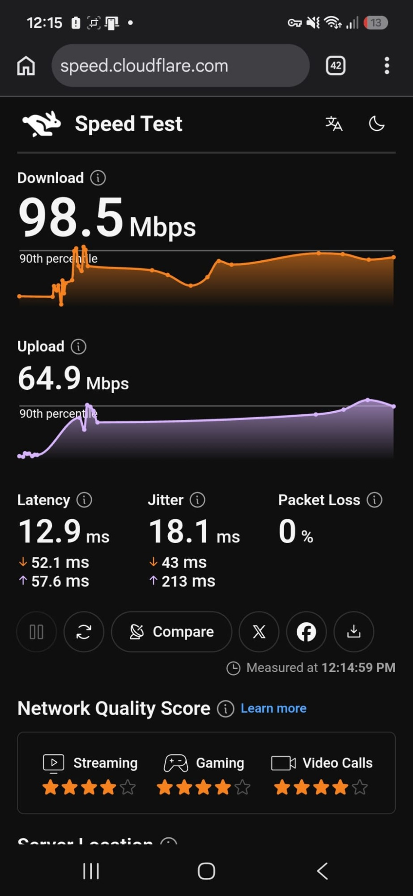
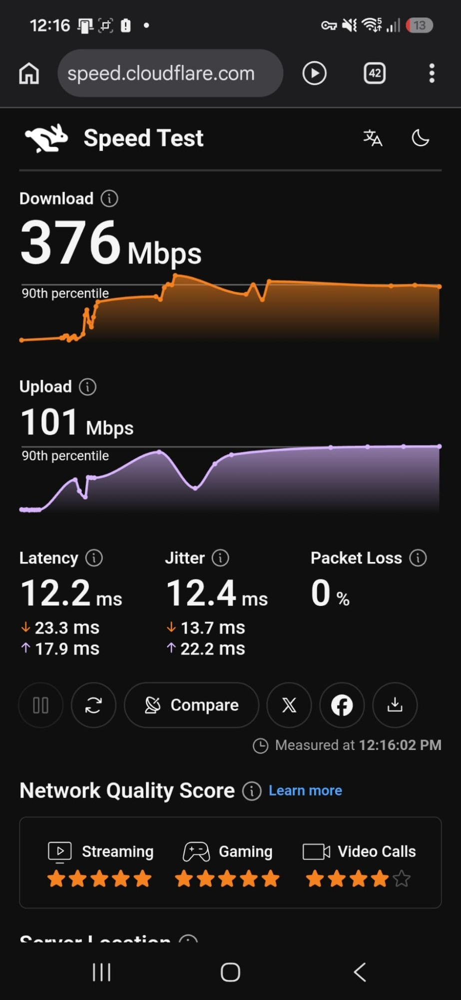
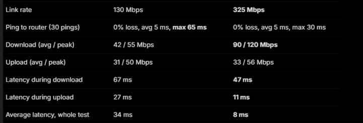
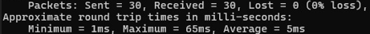
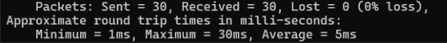

<p align="center">
  
</p>

<h1 align="center">Wi-Fi Improver</h1>

<p align="center">
  <strong>Sequential home Wi-Fi &amp; network diagnostics, root-cause fixes, and verified Before vs. After benchmarking.</strong><br>
  No placebo registry tweaks. No new hardware. Works on any home network worldwide.
</p>

<p align="center">
  
  
  
  
</p>

---

## Proof: Real Before vs. After Results ($0 Hardware Cost)

Applying this sequential **diagnose → fix → re-measure** protocol to a typical gigabit fiber home network (dual-band Wi-Fi 5 ISP gateway, wired desktop, and Wi-Fi laptop/phone) unlocked massive gains purely through RF channel selection, disabling aggressive Band Steering, and replacing a flaky router DNS relay:

| Device / Metric | Before | After | Improvement |
|---|---:|---:|---|
| **Mobile Wi-Fi Download** | 98.5 Mbps | **376 Mbps** | **3.8× faster (+282%)** |
| **Mobile Wi-Fi Upload** | 64.9 Mbps | **101 Mbps** | **+56% (line rate)** |
| **Mobile Download Loaded Latency** | 52.1 ms | **23.3 ms** | **-55% lag under load** |
| **Mobile Upload Loaded Latency** | 57.6 ms | **17.9 ms** | **-69% lag under load** |
| **Mobile Upload Jitter** | 213 ms | **22.2 ms** | **-90% jitter** |
| **Laptop Wi-Fi Link Rate** | 130 Mbps (2.4 GHz) | **325 Mbps (5 GHz)** | **2.5× link rate** |
| **Laptop Wi-Fi Download (Avg / Peak)** | 42 / 55 Mbps | **90 / 120 Mbps** | **2.1× faster** |
| **Laptop Average Latency (Whole Test)** | 34 ms | **8 ms** | **-76% latency** |
| **Laptop Router Ping Max Spike (30 pkts)** | 65 ms | **30 ms** | **-54% spike** |
| **Desktop DNS Reliability (10 lookups)** | 9/10 (10% drop) | **10/10 (0% drop)** | **Zero DNS timeouts** |

### Visual Proof

#### 1. Wi-Fi Speed & Loaded Latency (Cloudflare Speed Test)

<table>
  <tr>
    <th align="center">Before (Shared SSID + DFS Ch 60 + Router DNS)</th>
    <th align="center">After (Split 5 GHz SSID + Clean Ch 36 + 1.1.1.1 DNS)</th>
  </tr>
  <tr>
    <td align="center"></td>
    <td align="center"></td>
  </tr>
</table>

#### 2. Laptop Wi-Fi Summary (2.4 GHz → 5 GHz Ch 36)

<p align="center">
  
</p>

#### 3. Laptop 30-Packet Ping to Router (Max Spike Cut in Half)

<table>
  <tr>
    <th align="center">Before (Max 65 ms)</th>
    <th align="center">After (Max 30 ms)</th>
  </tr>
  <tr>
    <td align="center"></td>
    <td align="center"></td>
  </tr>
</table>

---

## Why This Works (The Sequential Protocol)

Most home Wi-Fi troubleshooting fails because people run a single speed test and apply random "Windows gaming network tweaks" (placebo). **Wi-Fi Improver** isolates each layer strictly **one phase at a time** so throughput traffic never contaminates idle latency:

1. **Link & RF Congestion Audit** — Inspect active PHY mode, band, channel, width, packet errors, and scan competing access points per channel (accounting for both co-channel and destructive adjacent-channel overlap).
2. **Idle Hop-by-Hop Latency & Stability** — Measure idle background traffic, 30-packet pings to the gateway and `1.1.1.1`, IPv6 state, and a 5-hop traceroute to separate local Wi-Fi/LAN jitter from ISP routing.
3. **DNS Latency & Reliability** — Benchmark direct UDP queries against the router's DNS relay, `1.1.1.1`, and `8.8.8.8` to catch silent lookup drops and tiny router caches.
4. **Throughput & Bufferbloat Under Load** — Saturate downlink and uplink sequentially while probing ICMP + HTTP RTT to compute loaded latency delta, responsiveness (RPM), and bufferbloat grade (`A+` to `F`).

### Root Causes Found in This Case Study

1. **5 GHz Auto-Channel Collision + DFS**: The router's `Auto` selector parked 5 GHz on DFS Channel 60 (`52–64`), colliding with **8 competing neighbor BSSIDs** while non-DFS **Channels 36–48 had 0 APs**.
2. **Aggressive Band Steering on a Shared SSID**: Broadcasting one SSID across 2.4 GHz and 5 GHz caused dual-band devices to get pinned onto congested 2.4 GHz or cling to weak 5 GHz with **45.9% packet retries**. Splitting 5 GHz into its own SSID cleanly disabled steering.
3. **Flaky Router DNS Relay**: The gateway's 100-entry DNS relay dropped 10% of test queries and logged OS DNS timeout warnings. Moving clients to `1.1.1.1` + `8.8.8.8` (with DoH) fixed lookup reliability immediately.

> Full numbers and analysis live in [`results/case-study.md`](results/case-study.md) and [`docs/methodology.md`](docs/methodology.md).

---

## Quick Start

### Windows (Full 4-Step Sequential Benchmark)

Requires **Windows 10/11** (PowerShell) and optionally **Node.js 18+** for Step 4 loaded throughput & bufferbloat:

```powershell
# Run full sequential benchmark and save baseline JSON
.\scripts\benchmark.ps1 -OutJson results\local-before.json

# Quick check (skip throughput load test)
.\scripts\benchmark.ps1 -SkipLoad
```

### Cross-Platform Throughput & Bufferbloat Only (Windows / macOS / Linux)

Zero npm dependencies — runs directly on **Node.js 18+**:

```bash
node scripts/netbench.mjs
node scripts/netbench.mjs --duration 12 --streams 6 --json
```

### Apply Fixes & Re-Measure

1. Follow the vendor-agnostic checklist in [`docs/fix-playbook.md`](docs/fix-playbook.md).
2. Re-run the exact same benchmark:
   ```powershell
   .\scripts\benchmark.ps1 -OutJson results\local-after.json
   ```
3. Compare your Markdown tables side by side.

---

## Built With AI Agents (Run It Yourself)

This entire diagnostic session — running the sequential probes, reading router radio/client telemetry, analyzing RF channel overlap, generating click-by-click router fixes, applying DNS safely with backups, and verifying the after-measurements — was orchestrated with AI coding agents.

Want to run the exact same workflow on your own home network? Copy the reusable prompt in **[`docs/agent-prompt.md`](docs/agent-prompt.md)** into your AI coding agent.

> **Note on Router Logins & AI Guardrails:** Reading router radio stats or applying Wi-Fi changes requires logging into your router's local admin IP (e.g., `192.168.x.x` or `10.x.x.x`) with its username and password. Some hosted/commercial AI models have strict safety guardrails and may refuse to access local gateway IPs or handle router credentials—even on your own network. If your model refuses:
> - **Do the router step yourself (recommended):** Log into the router in your browser and paste a screenshot of its Wireless Settings page into the chat instead of sharing credentials.
> - **Or use an open-source / local model** (or one without restrictive local-network guardrails) if you want the agent to inspect the router directly. (If you ever paste a router password into a cloud chat, change it afterward.)

---

## Repository Structure

```text
wifi-improve/
├── README.md
├── LICENSE
├── assets/
│   ├── icon.svg
│   └── proof/
│       ├── speedtest-before.jpg
│       ├── speedtest-after.jpg
│       ├── laptop-stats-comparison.png
│       ├── ping-before.png
│       └── ping-after.png
├── scripts/
│   ├── benchmark.ps1        # Windows 4-step sequential diagnostic suite
│   └── netbench.mjs         # Cross-platform Node.js throughput & bufferbloat bench
├── docs/
│   ├── methodology.md       # Sequential testing, RF math, DFS, Band Steering & bufferbloat
│   ├── fix-playbook.md      # Vendor-agnostic fixes + rollback/undo commands
│   └── agent-prompt.md      # Copy-paste AI agent prompt for any home network
└── results/
    └── case-study.md        # Sanitized Before vs. After case study
```

---

## Privacy & Security Note

All personal identifiers (SSIDs, passwords, MAC addresses, hostnames, private/public IPs, and ISP-specific details) have been stripped from this repository. Local benchmark outputs (`results/local-*.json`, `dns-backup*.txt`, raw dumps) are excluded via `.gitignore`.

## License

[MIT](LICENSE)

*Inspired by [Bruno Volpato's Wi-Fi diagnostic prompt](https://x.com/brunovolpato/status/2124706066516885709).*
